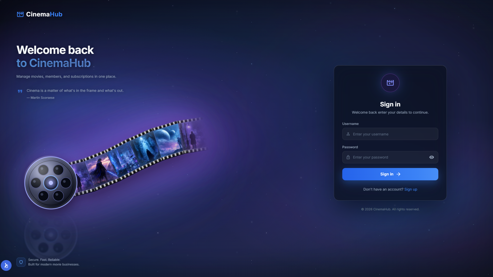
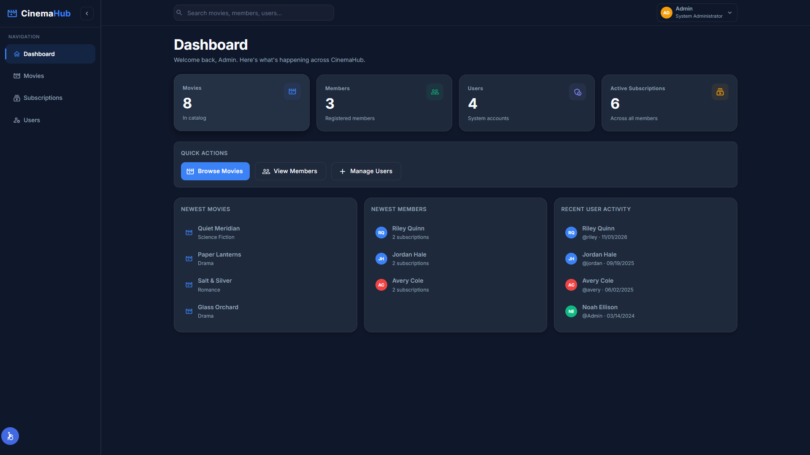
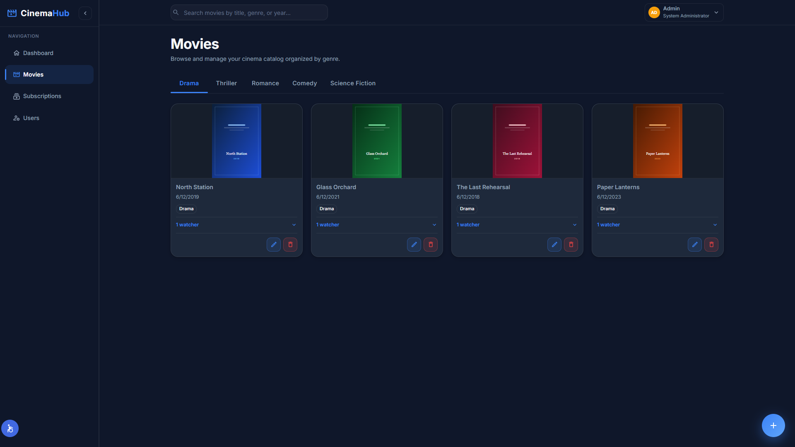
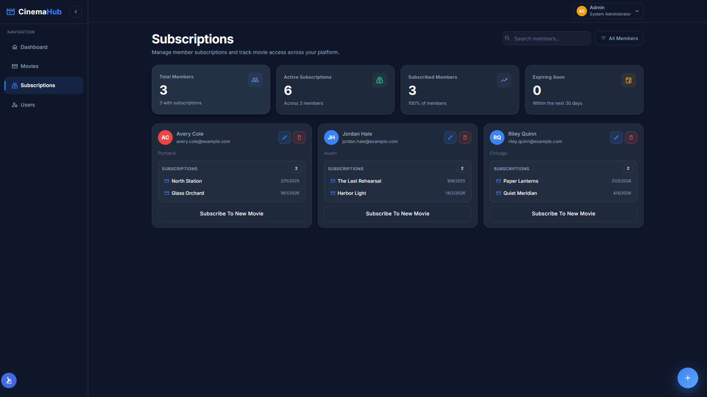
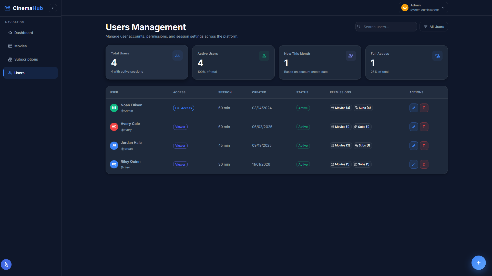
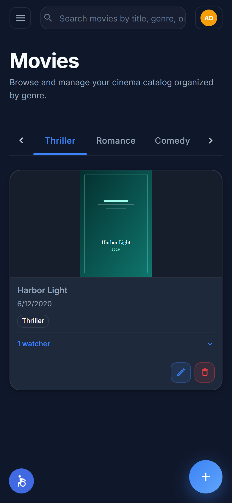

# CinemaHub

**A cinema operations workspace for movies, members, subscriptions, and role-based administration.**

[Live Demo](https://cinemahub-xi3w.onrender.com) · [Users API](https://movies-user-backend.onrender.com) · [Catalog API](https://movies-subscription-backend.onrender.com)



## Product overview

CinemaHub gives a cinema team one dark workspace. People sign in, browse the catalog, manage members and the movies they have watched, and administrators manage accounts and permissions.

The public name is CinemaHub. The mark is a film icon with “Hub” in blue (`#3B82F6`) on the slate background (`#0F172A`).

## Key features

- Sign-in, demo registration, and a required password change for accounts an administrator creates
- Movies, members, subscriptions, and an administrator user directory
- Navigation and actions that follow the signed-in account’s permissions
- Header search on Home and Movies, and page search on Members and Users
- Session countdown and disconnect, including a locked session when the timeout is `0`
- Desktop registration scene that uses the included 3D models
- Accessibility trigger in the page shell
- Layouts for phone, tablet, and desktop

## Product views

**Dashboard**



**Movies**



**Subscriptions**



**Users**



**Phone**



## Architecture

| Layer | Technology |
| --- | --- |
| Interface | React 18, Vite 5, React Router, Redux Toolkit, Material UI, Framer Motion |
| Users API | Node.js 20, Express, MongoDB, JWT, bcrypt, Helmet |
| Catalog API | Node.js 20, Express, MongoDB, JWT, Helmet |
| Data | MongoDB Atlas. Accounts and the catalog share one database |
| Hosting | Render static site, plus two Render web services |

```text
client/            This repository. React interface
cinema-ws          Users, authentication, and sessions
subscriptions-ws   Movies, members, and subscriptions
```

The three repositories deploy separately. The browser receives the API origins at build time. Both APIs share one JWT secret and one database.

## Authentication and authorization

- Sign-in returns a JWT. The browser sends it as `Authorization: Bearer <token>`
- An administrator token lasts 24 hours. A regular token lasts for the account’s `sessionTimeout` minutes
- Changing a password or editing a user advances `tokenVersion` and rejects older tokens
- An administrator-created account must change the temporary password before other API calls succeed
- Page links and create, update, and delete actions follow the permission list on the account
- Disconnect can lower the remaining session time. It cannot raise it. A timeout of `0` locks the account until an administrator restores it
- The server enforces access. The interface only hides actions the account cannot perform

## Verification

```bash
npm run lint
npm run build
```

`npm run lint` allows zero warnings. `npm run build` writes the static site to `dist/`. This repository does not include a browser test script. The API repositories contain the automated authentication, permission, and catalog suites.

## Local development

Requirements: Node.js 20 or newer, npm, and both API repositories running.

```bash
npm install
```

Copy `.env.example` to `.env`.

| Variable | Purpose |
| --- | --- |
| `VITE_CINEMA_WB` | Users API origin, with no path. Local: `http://localhost:3000` |
| `VITE_SUBSCRIPTIONS_WB` | Catalog API origin, with no path. Local: `http://localhost:3001` |

Vite reads these when the dev server starts and when `npm run build` runs. Restart Vite, or build again, after changing them. Never commit `.env`.

```bash
npm run dev
```

## Deployment

The public site is [cinemahub-xi3w.onrender.com](https://cinemahub-xi3w.onrender.com). Build with `npm install; npm run build` and publish `./dist`.

Set `VITE_CINEMA_WB` to `https://movies-user-backend.onrender.com` and `VITE_SUBSCRIPTIONS_WB` to `https://movies-subscription-backend.onrender.com` before the build.

Direct navigation uses React Router in the browser. The static site needs one rewrite: source `/*`, destination `/index.html`. Put specific rules above that catch-all.

`public/og.jpg` is the social preview. `public/favicon.svg` is the tab icon. `theme-color` is `#0F172A`. `public/robots.txt` allows indexing. The accessibility widget is `public/nagishli_beta.js` and `public/nagishli-files/`. The registration scene needs the GLB files under `src/assets/models/`.

The earlier site at [movies-jps0.onrender.com](https://movies-jps0.onrender.com) remains available. The free API instances sleep after a period without traffic. The first request after sleep waits for the process to start.

## Related repositories

| Service | Local URL | Repository |
| --- | --- | --- |
| This interface | Vite dev server | [Movies](https://github.com/maornetzer9/Movies) |
| Users and authentication | `http://localhost:3000` | [Movies-User-Backend](https://github.com/maornetzer9/Movies-User-Backend) |
| Movies and subscriptions | `http://localhost:3001` | [Movies-Subscription-Backend](https://github.com/maornetzer9/Movies-Subscription-Backend) |

## License

All rights reserved. No public license has been granted.
